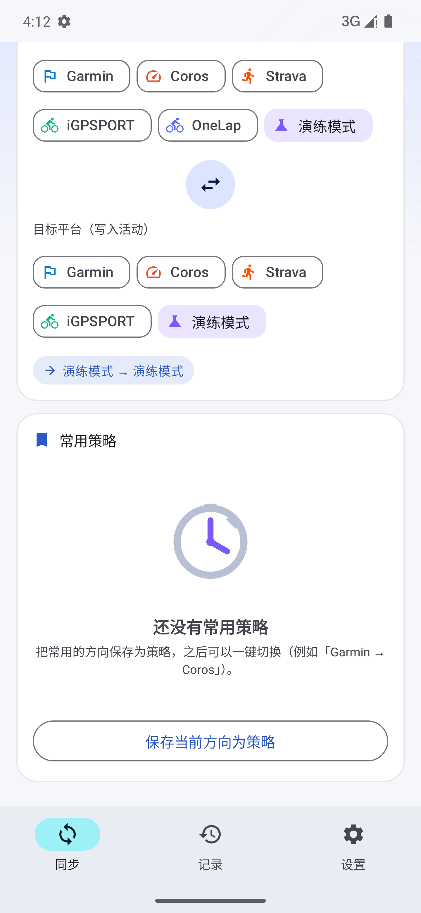
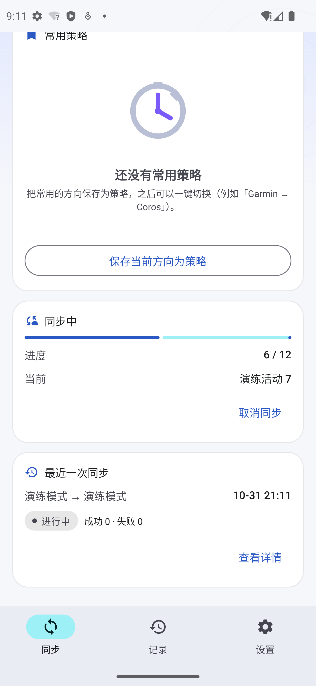
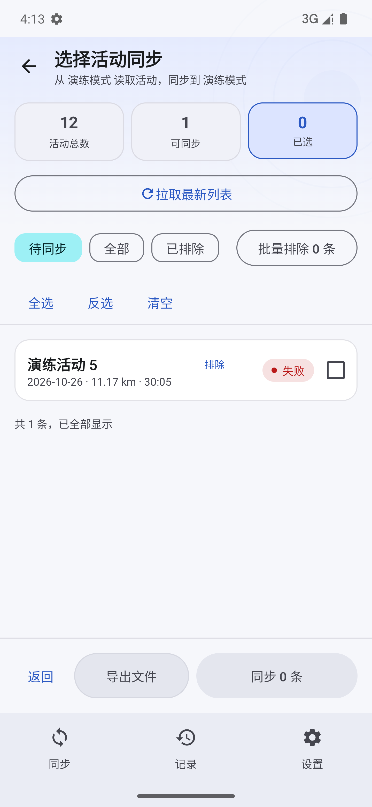
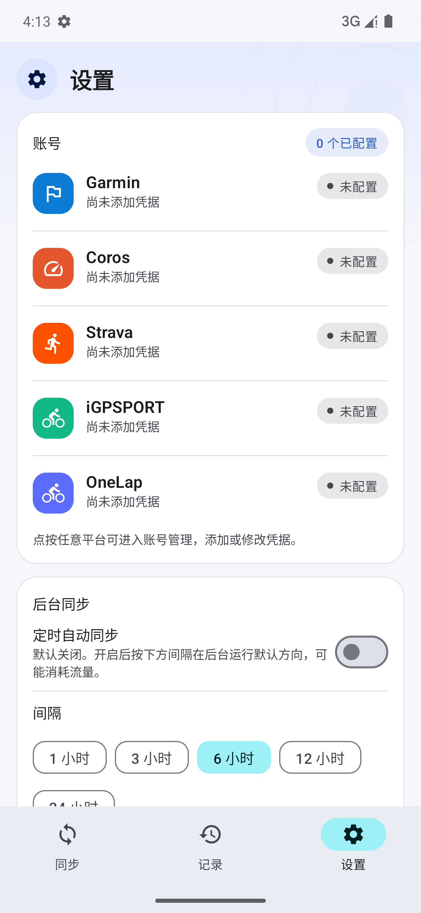
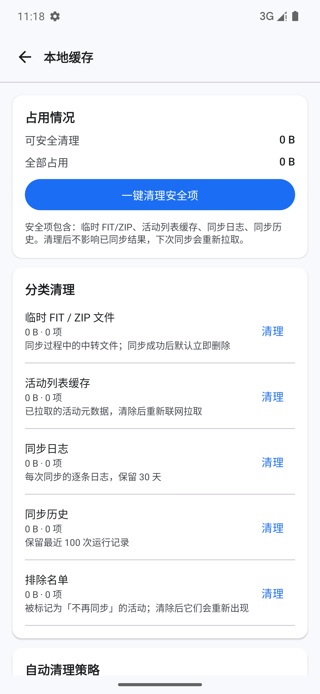
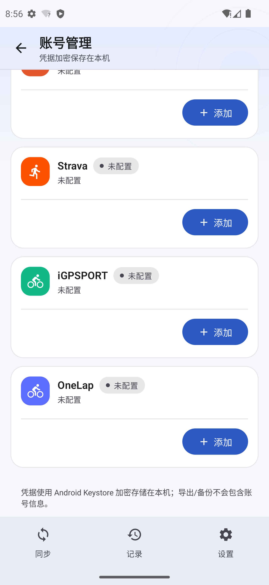
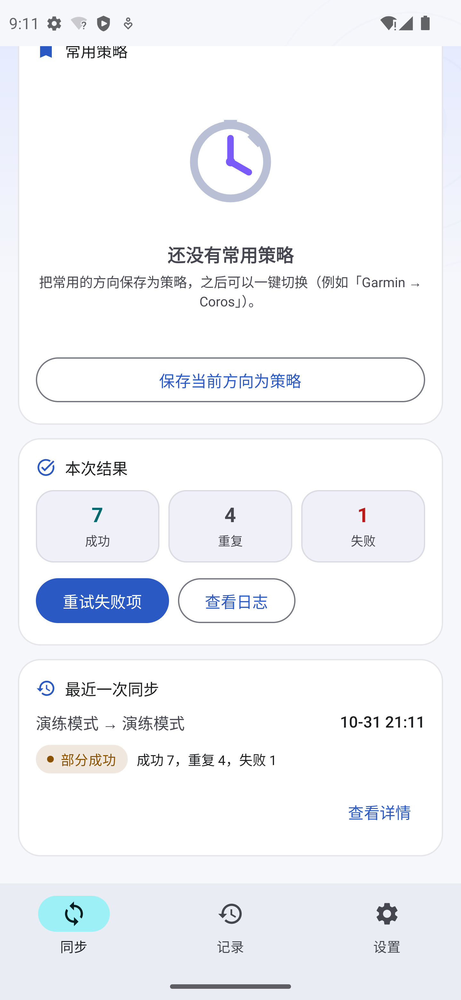

<div align="center">

# SportFit Sync for Android

**把 Garmin / Coros / Strava / iGPSPORT / OneLap 的运动记录，在手机上一键搬到另一个平台。**

[](https://kotlinlang.org)
[](https://developer.android.com)
[](https://developer.android.com/jetpack/compose)
[](https://developer.android.com/training/data-storage/room)
[](https://developer.android.com/about/versions)

[快速开始](#快速开始) · [功能特性](#功能特性) · [同步方向矩阵](#同步方向矩阵) · [架构](#架构) ·
[开发手册](docs/development-handbook.md) · [平台协议](docs/platform-protocols.md) · [设计稿](docs/design-and-ux-proposal.md)

</div>

---

## 📖 这是什么

**SportFit Sync** 是一款纯本地运行的 Android 运动记录同步应用。

连接两个运动平台的账号后，它会把**源平台**的活动文件（原始 `.fit` / `.zip`）下载下来，
经归一化处理后原样上传到**目标平台**——文件是活动本体，而不是平台导出的 CSV 摘要，
所以路线、功率、心率、踏频等原始数据都能完整保留。

它解决的是一个很具体的问题：同一条骑行，你记录在 Garmin 上，但想在 Coros 的社交
排行榜里看到它；或者你从 Strava 换到了 iGPSPORT，历史数据不想丢。原来的做法是跑
Python 脚本 + GitHub Actions 定时任务 + 手动改 SQLite 去重表，而本项目把整条链路搬进了
手机，并且顺手修掉了上游的几个已知缺陷。

**它不是**：社交 App、训练数据分析工具、或者云端同步服务。所有数据都在你的设备上，
所有网络请求都由你的手机直接发往各平台。

---

## ✨ 功能特性

| | |
|---|---|
| **12 条同步方向** | 5 个源平台 × 3 个目标平台，任意组合（详见[同步方向矩阵](#同步方向矩阵)） |
| **跨账号去重** | 内容指纹识别「同一份数据换了新 activityId」，避免在目标端制造副本 |
| **失败可重试** | 单条失败不影响整批；失败项自动重试，也能一键重跑失败集 |
| **可取消 · 可观察** | 实时进度、逐条日志、前台服务保活，切到后台也不中断 |
| **本地历史库** | 绑定账号时全量拉取（上限 5000 条），之后只做增量；老活动也能排上队 |
| **离线导出** | 一键把活动写成 `.fit` 存进 `下载/SportFitSync`，不依赖任何平台在线 |
| **缓存可视可控** | 6 类缓存分别统计体积；安全项一键清理，危险项二次确认 |
| **凭据加密** | Android Keystore 硬件密钥 + AES-256-GCM，库中不落明文 |
| **后台定时同步** | WorkManager 周期任务（联网约束），默认关闭，可标记某个策略为后台方向 |
| **演练模式** | 内置合成平台，无需账号/网络即可在设备上跑通全流程（仅 Debug 构建） |

---

## 📱 界面

| 同步（方向选择） | 选择活动 | 同步进行中 | 活动选择页 |
|---|---|---|---|
|  |  |  |  |

| 设置 | 本地缓存 | 账号管理 | 同步结果 |
|---|---|---|---|
|  |  |  |  |

> 完整截图与流程记录见 [`docs/screenshots/`](docs/screenshots/)。

---

## 🔀 同步方向矩阵

方向由「源 × 目标」组合产生，**不需要为每个方向单独写脚本**。

| 源 ↓ / 目标 → | Garmin | Coros | Strava |
|:---|:---:|:---:|:---:|
| **Garmin** | — | ✅ | ✅ |
| **Coros** | ✅ | — | ✅ |
| **Strava** | ✅ | ✅ | — |
| **iGPSPORT** | ✅ | ✅ | ✅ |
| **OneLap** | ✅ | ✅ | ✅ |

**5 个源 × 3 个目标 − 3 个自环 = 12 条方向。** 这条矩阵由
[`SyncDirectionMatrixTest`](app/src/test/java/com/sportfit/sync/domain/SyncDirectionMatrixTest.kt)
钉死：它把每一条方向逐一对应到上游 Python 项目的 `<src>_sync_<dst>.py` 脚本，
少一条就编译失败——**方向数变了，你会立刻知道**。

`iGPSPORT` 与 `OneLap` 只能作源，与上游项目保持一致（这两个平台不提供导入接口）。

---

## 🏗 架构

```
app/src/main/java/com/sportfit/sync/
├── domain/          Models.kt（Platform / SyncDirection / SyncStatus / UploadOutcome）
│                    ActivityFingerprint.kt（内容指纹，纯函数）
├── core/
│   ├── net/         OkHttp 双档客户端 · CookieJar · RFC3986 编码 · MD5/SHA-256/HMAC
│   ├── crypto/      CryptoBox（Android Keystore + AES-256-GCM）
│   ├── format/      FitPackaging（ZIP ↔ FIT 归一化）
│   ├── oss/         Coros STS 凭证 · 阿里云 V1 签名 · AWS SigV4 签名
│   └── util/        TimeParsing
├── platform/        PlatformGateway 抽象 + 各平台客户端
│   ├── garmin/      SSO → OAuth1 → OAuth2 → MFA
│   ├── coros/       MD5 密码 → regionId → OSS 中转上传
│   ├── strava/      OAuth2（内嵌 WebView 回调）
│   ├── igpsport/    Bearer token，cn/global 双站点
│   ├── onelap/      明文 HTTP + MD5（域名白名单）
│   └── demo/        演练平台（仅 Debug）
├── data/
│   ├── local/       Room 7 张表（实体 / DAO / 迁移）
│   ├── prefs/       DataStore 设置
│   └── repo/        AccountRepository（加解密边界）
├── sync/            SyncEngine · SyncPlanner · ExportEngine · SyncService · SyncProgressBus
├── export/          ActivityExporter（写 Downloads）
├── cache/           CacheManager（分类统计 / 清理 / 保留策略）
├── work/            SyncScheduler · SyncWorker（WorkManager）
└── ui/              Compose 界面（AppViewModel 为单一 VM）
```

### 关键设计决策

**① 平台抽象收敛成「源 × 目标」**
上游是 12 个 Python 脚本各写一遍下载上传。本项目定义三个接口——`PlatformSource`
（列出与下载）、`PlatformTarget`（上传）、`PlatformGateway`（工厂，构造即登录）——
方向由 UI 组合产生，**新增一个平台只需实现一个接口**。

> 注意 `PlatformSource.download()` 的入参是完整的 `ActivityMeta` 而不是裸 id：
> Coros 的 `activity/detail/download` 要求 `sportType` 精确匹配，只传 id 会让
> 所有非跑步活动下载失败。

**② 账本按方向建键，而不是按平台建列**
上游用 `is_sync_coros` / `is_sync_garmin` / `is_sync_strava` 三个布尔列表达状态。
本项目用 `sync_records` 表，主键 `(sourcePlatform, targetPlatform, activityId)`——
同一条 Garmin 活动可以同时同步到 Coros 和 Strava 而互不干扰。

**③ 失败自动重试**
上游查询是 `WHERE is_sync_x = 0`，导致状态 `2`（异常）的活动**永远不会重试**，只能手工改库。
本项目的 [`SyncPlanner`](app/src/main/java/com/sportfit/sync/sync/SyncPlanner.kt) 把
`FAILED` 与 `UNSYNCED` 同等对待，失败项自动进入下一轮候选。

**④ 内容指纹补上 activityId 的窟窿**
账本按 activityId 建键，但 activityId 不是「这条活动」的稳定名字：重新导入同一份 FIT 会产生新 id，
换同平台另一个账号 id 也来自不同命名空间。[`ActivityFingerprint`](app/src/main/java/com/sportfit/sync/domain/ActivityFingerprint.kt)
对「开始时间 + 名称 + 距离 + 时长 + 运动类型」做归一化后取 SHA-256，
命中「本方向已同步」指纹集的活动按已同步处理。**只用列表元数据，绝不哈希 FIT 内容**——
否则每条活动都得先下载才知道是不是传过了。

**⑤ 用 `channelFlow` 而不是 `flow`**
平台客户端会在自己的 `withContext(Dispatchers.IO)` 内部打日志；在 `flow {}` 里这会触发
`Flow invariant is violated` 而中断整个同步。两个引擎都改用 `channelFlow {}` + `send()`，
因为 `send` 基于 Channel，允许从任意上下文调用。

**⑥ 演练平台模仿真实实现的代码形态**
`DemoGateway` 被刻意写成与真实客户端一样的结构（同样 `withContext`、同样打日志）。
**替身的价值取决于它与真实实现共享多少代码路径**——一个「更干净」的替身反而会掩盖缺陷。

---

## 🗄 数据模型

Room 数据库 `sportfit-sync.db`，**当前版本 3**，`exportSchema = true`，
schema JSON 落在 [`app/schemas/`](app/schemas/)。

| 表 | 主键 | 说明 |
|---|---|---|
| `accounts` | `platform` | 账号与加密凭据。`emailCipher` / `secretCipher` / `tokenCipher` 均为 Keystore 密文 |
| `cached_activities` | `(platform, activityId)` | 本地活动历史库，**同步与导出的全集来源** |
| `sync_records` | `(sourcePlatform, targetPlatform, activityId)` | 去重账本。含 `status` / `attempts` / `lastError` / `fingerprint` |
| `sync_jobs` | `id` (auto) | 每次运行的统计：方向、状态、成功/重复/失败计数 |
| `sync_logs` | `id` (auto) | 逐条运行日志，带级别（`INFO`/`WARN`/`ERROR`/`SUCCESS`） |
| `exclusions` | `(sourcePlatform, targetPlatform, activityId)` | 永久排除名单 |
| `strategies` | `id` (auto) | 常用方向，可命名，至多一个标记为后台方向 |

**迁移必须是非破坏性的。** `accounts` 存着用户刚配好的加密凭据，`sync_records` 是去重账本——
一旦 `fallbackToDestructiveMigration` 被触发，两者会一起消失（用户要重新输密码，
且所有活动会被当成没同步过再传一遍）。所以每次升版本都写显式 `Migration` 并注册：

```kotlin
val MIGRATION_2_3 = object : Migration(2, 3) {
    override fun migrate(db: SupportSQLiteDatabase) {
        db.execSQL("ALTER TABLE sync_records ADD COLUMN fingerprint TEXT NOT NULL DEFAULT ''")
    }
}
// build(): .addMigrations(MIGRATION_2_3)
```

由 [`AppDatabaseMigrationTest`](app/src/androidTest/java/com/sportfit/sync/data/local/AppDatabaseMigrationTest.kt)
用 `MigrationTestHelper` 重建 v2 库、塞进账号和账本、迁到 v3 后断言两者都还在。

### 关键常量

| 常量 | 值 | 位置 |
|---|---|---|
| `SyncEngine.HISTORY_LIMIT` | `5_000` | 绑定账号时的全量拉取上限 |
| `AppSettings.listLimit` | `200` | 单次同步处理的条数上限 |
| `AppSettings.backgroundIntervalHours` | `6` | 后台同步间隔（实际被钳制到 1–24 小时） |
| `CachePolicy.logRetentionDays` | `30` | 日志保留天数 |
| `CachePolicy.jobHistoryLimit` | `100` | 历史运行保留条数 |
| `SyncStatus` | `UNSYNCED=0` `SYNCED=1` `FAILED=2` | 账本状态码 |
| `SyncJobEntity.status` | `RUNNING` `SUCCESS` `PARTIAL` `FAILED` `CANCELLED` | 运行状态 |
| `AccountEntity.status` | `CONNECTED` `NEEDS_LOGIN` `ERROR` | 账号状态 |
| `CryptoBox` 别名 | `sportfit.credentials.v1` | Keystore 密钥别名 |
| `CacheManager.TEMP_DIR_NAME` | `fit-cache` | 临时中转目录 |

### 关于 FIT 文件

**项目里没有 FIT 编码器。** FIT 字节流始终来自源平台——本项目只做两件事：

1. **归一化容器**（[`FitPackaging`](app/src/main/java/com/sportfit/sync/core/format/FitPackaging.kt)）：
   按魔数 `PK\x03\x04` 判断 ZIP 与否（不依赖 `Content-Type`），
   `ensureRawFit()` 解包出裸 FIT（Garmin / Strava 拒绝 ZIP），
   `ensureZip()` 打成 ZIP（Coros 导入只接受 ZIP 对象）。
2. **命名导出文件**：清洗非法字符、折叠空白、截断到 40 字符。

唯一在应用内生成 FIT 字节流的地方是演练平台——它造一个带 `.FIT` 魔数头的合成文件，
用来在没有真实账号时验证整条流水线。

---

## ⚙️ 同步流水线

```
选方向 → 选活动 → 登录源/目标 → 增量拉取并合并进本地库
   ↓
SyncPlanner.selectCandidates()   ← 纯函数，排除名单 / 内容指纹 / 显式选择 / 状态
   ↓
SyncPlanner.applyLimit()         ← 显式勾选不受上限限制
   ↓
逐条处理（每条独立 try/catch）：
   source.download(activity)
     → 落盘到 cache/fit-cache/job-{id}/
     → FitPackaging 归一化（Coros 要 ZIP，Garmin/Strava 要裸 FIT）
     → target.upload(payload)
     → Success / Duplicate ⇒ 账本置 SYNCED
       Failed / 异常        ⇒ 账本置 FAILED（错误截断 500 字符）
   ↓
收尾：成功项立即删除临时文件；整轮结束统一 applyRetention()
```

**失败隔离**：单条活动抛异常只标记该条并继续后面的活动，整批不会中断——
这是上游脚本「一处 upload 异常就 `exit()`」的对照修复。

**可取消**：`CancellationException` 走 `NonCancellable` 把任务落成 `CANCELLED` 状态再抛出。

### 去重的两道闸

| 机制 | 依据 | 作用 |
|---|---|---|
| 账本状态 | `(source, target, activityId)` | 同一方向、同一 id 的活动不重复上传 |
| 内容指纹 | SHA-256(时间+名称+距离+时长+类型) | 换了 activityId 的同一份数据也不重复上传 |

**取舍（写在这里以免被当成 bug 改回去）**：显式勾选的活动**仍然**套用指纹规则——
内容完全重复再传一遍只会在目标端产生副本。真要重复同步，请用「重新同步已同步项」
（`includeAlreadySynced`），它会绕过指纹规则。

> ⚠️ **Coros 不按内容去重。** 重新导入账号里已有的活动，Coros 会新建一条同名、同时长、
> 同距离的副本；而且每次打包的 ZIP 含时间戳，md5 每次都不同 → 对象键
> `fit_zip/{userId}/{md5}.zip` 每次都是新对象。所以 Coros 侧的兜底**完全依赖本项目的账本**。
> 勾选「重新同步已同步项」前请知情。

---

## 🌐 平台实现

各平台的协议细节以 [`docs/platform-protocols.md`](docs/platform-protocols.md) 为准
（内容来自对 `garth` 源码与上游 HTTP 报文逐行比对，而非记忆）。

| 平台 | 认证 | 下载 | 上传 | 区域 |
|---|---|---|---|---|
| **Garmin** | SSO → ticket → OAuth1 (HMAC-SHA1) → OAuth2；支持 MFA 弹窗 | `download-service/files/activity/{id}` → **ZIP** | `upload-service/upload` multipart；`202`+`uploadId` → 成功，`409`+`Duplicate Activity` → 重复 | `.com` / `.cn` |
| **Coros** | `account/login`，`pwd = MD5(明文)` → `accessToken` + `regionId` | `activity/detail/download` → `fileUrl` | **不能直传**：STS 取凭证 → OSS PUT → `activity/fit/import` 三步中转 | region 1/2/3 |
| **Strava** | OAuth2（自建应用），内嵌 WebView 拦截 `localhost/exchange_token` | `activities/{id}/export_original` | `POST /uploads` + 轮询处理完成 | 全球 |
| **iGPSPORT** | `account/login` → Bearer token | 活动详情 → `fitUrl` | —（仅作源） | `cn` / `global` |
| **OneLap** | 明文 HTTP + MD5 密码 | `analysis/list` → `durl` | —（仅作源） | 国内 |

### Coros 上传通道：一条会变的链路

Coros 不能直接接收文件，上传必须走 **STS 临时凭证 → OSS 上传 → 通知导入** 三步：

```
① GET https://trainingcn.coros.com/api/proxy/oss/sts?bucket=coros-oss&service=aliyun&v=2
   Cookie: CPL-coros-token=<登录返回的 accessToken>      ← 必须是 Cookie，头不被识别
   → {"code":200,"data":{"credentials":"<base64+salt>"}}
   → 去盐 9y78gpoERW4lBNYL → base64 → JSON → AccessKeyId / AccessKeySecret / SecurityToken

② PUT oss://coros-oss/fit_zip/{userId}/{md5}.zip
   region 2 (中国) → 阿里云 oss-cn-beijing，V1 签名
   region 1/3      → AWS s3.eu-central-1，SigV4 签名

③ POST {teamapi}/activity/fit/import
   form 字段 jsonParameter = {source, timezone:32, bucket, md5, size, object, serviceName, oriFileName}
   成功判定：result == "0000" 且 data.status == 2
```

**这条通道三周内变了两次**（2026-10-03 Coros 关闭了匿名 STS 接口）。
因此项目内置了可随时复测的**实时体检**工具
[`CorosLiveCheck`](app/src/test/java/com/sportfit/sync/platform/coros/CorosLiveCheck.kt)：
凭据只从环境变量读，不设变量就跳过，不污染常规单测。

```bash
export COROS_EMAIL='you@example.com' COROS_PASSWORD='…'
./build.sh :app:testDebugUnitTest --tests "*CorosLiveCheck" --rerun --console=plain -i
# COROS_LIVE_STAGES=a,b,c,d,e 可选阶段；d 会在账号里新建活动，常规体检不要带
```

---

## 🧹 缓存策略

| 分类 | 内容 | 默认 | 风险 |
|---|---|---|---|
| 临时 FIT / ZIP | `cacheDir/fit-cache/job-{id}/` | 同步成功后立即删除；失败保留供排查 | 无 |
| 活动列表缓存 | `cached_activities` | 已配置账号的列表**长期保留** | 无 |
| 同步日志 | `sync_logs` | 保留 30 天 | 无 |
| 同步历史 | `sync_jobs` | 保留最近 100 条 | 无 |
| 排除名单 | `exclusions` | 手动清理 | 无 |
| **同步去重记录** | `sync_records` | **不自动清** | ⚠️ 清除后全部活动会被视为未同步 |
| **账号与凭据** | `accounts` + Keystore | **不自动清** | ⚠️ 需重新登录 |

**「安全项一键清理」不会碰账本**，危险项需要二次确认并明确告知后果。
（账号与凭据不是缓存页上的一个分类，而是被当作危险操作保护起来——清理账号要走账号管理页。）

> 注意：已配置账号的活动列表**不再按时间自动清理**——那份列表就是增量同步的本地历史，
> 按时间删会让「还没来得及同步的老活动」永远失去机会。

---

## 🔐 安全与隐私

- **凭据永不明文落库**：`CryptoBox` 用 Android Keystore 里的硬件密钥做 AES-256-GCM
  加密，密文格式 `v1:base64(iv‖ciphertext‖tag)`；编辑表单也不会回显已保存的密码。
- **不备份到云端**：`android:allowBackup="false"` + `dataExtractionRules`，密文不会被
  同步进 Google 备份。
- **明文流量限定域名**：OneLap 本身只有 HTTP 接口，通过
  [`network_security_config.xml`](app/src/main/res/xml/network_security_config.xml)
  精确放行 `www.onelap.cn` 与 `u.onelap.cn` 两域，而不是全局开启明文。
- **所有请求由手机直发**，没有自建中转服务器，平台拿到的只有来自你设备 IP 的请求。

---

## 🛠 快速开始

### 前置条件

| 组件 | 版本 | 说明 |
|---|---|---|
| JDK | **17+** | 推荐 Android Studio 内置 JBR（21） |
| Android SDK | platform 36 + build-tools 36.1.0 | 路径写进 `local.properties` |
| Gradle | 8.11.1 | **无需手动安装**，`build.sh` 会自动准备 |

### 三步构建

```bash
# 1. 告诉 Gradle 你的 SDK 在哪（此文件已被 gitignore，换机器需重建）
echo "sdk.dir=$HOME/Library/Android/sdk" > local.properties

# 2. 构建
./build.sh :app:assembleDebug
#    产物：app/build/outputs/apk/debug/app-debug.apk

# 3. 安装到设备
~/Library/Android/sdk/platform-tools/adb install -r app/build/outputs/apk/debug/app-debug.apk
```

> **为什么要用 `./build.sh` 而不是 `gradle`？**
> 本机 PATH 上没有 Gradle，且沙箱环境下 `~/.gradle` 与 `~/.android` 不可写。
> `build.sh` 会把 Gradle 发行版、`GRADLE_USER_HOME`、`ANDROID_USER_HOME`
> 全部放进工程内的 `.tools/` / `.gradle-home/` / `.android-home/`（均可随时删除重建），
> 并自动指向 Android Studio 的 JBR。**所有可写产物都在工程内，不污染全局状态。**

### 常用命令

```bash
./build.sh :app:assembleDebug            # 构建 debug APK
./build.sh :app:testDebugUnitTest        # JVM 单元测试（78 项，秒级）
./build.sh :app:connectedDebugAndroidTest # 仪器测试（18 项，需模拟器在线）
./build.sh clean                         # 清理构建产物
```

> ⚠️ `connectedDebugAndroidTest` **跑完会卸载应用**，已配置的真实账号与 Keystore 密钥会一并消失。
> 跑完记得重新 `adb install -r`。

### 常用调试入口

**演练模式**（仅 Debug 构建可见）：源和目标都选「演练模式」，不需要账号、不联网，
用 12 条合成活动跑通全流程。行为是确定性的——`demo-5` 固定失败，ID 能被 3 整除的返回「重复」，
其余成功。

**按文本驱动的 UI 自动化**：[`tools/uitap.py`](tools/uitap.py) 通过 uiautomator 无障碍树
**按文本**定位控件，取代按像素猜坐标。

```bash
export PATH="$HOME/Library/Android/sdk/platform-tools:$PATH"
python3 tools/uitap.py --dump                  # 列出可见控件
python3 tools/uitap.py "选择活动同步"            # 找到并点击
python3 tools/uitap.py "拉取最新列表" --wait 8   # 等界面/网络
```

> Compose 布局一变，写死的像素坐标就失效——这是本项目 UI 验证反复失败的根因。

**设备端数据取证**：验证账本与计数器是否真的正确，比看 UI 可靠。

```bash
ADB=~/Library/Android/sdk/platform-tools/adb
SQLITE=~/Library/Android/sdk/platform-tools/sqlite3
PKG=com.sportfit.sync.debug
mkdir -p .dbcheck
for f in sportfit-sync.db sportfit-sync.db-wal sportfit-sync.db-shm; do
  $ADB exec-out run-as $PKG cat "databases/$f" > ".dbcheck/$f" 2>/dev/null
done
$SQLITE .dbcheck/sportfit-sync.db "select id,status,total,okCount,dupCount,failCount from sync_jobs;"
```

> ⚠️ **必须同时拉 `-wal` 和 `-shm`**。Room 默认 WAL 模式，只拉 `.db` 会拿到**过期快照**，
> 基于它下结论会得到错误的账本数据。

更完整的操作说明、模拟器启动、取证、排障速查表见
**[`docs/development-handbook.md`](docs/development-handbook.md)**。

---

## 🧪 测试

| 类型 | 数量 | 运行方式 |
|---|---|---|
| JVM 单元测试 | **78** 项 / 11 个测试类 | `./build.sh :app:testDebugUnitTest` |
| 仪器测试 | **18** 项 / 4 个测试类 | `./build.sh :app:connectedDebugAndroidTest` |

覆盖的关键行为：

- **FIT 归一化**（8 项）：ZIP ↔ FIT 双向、魔数判别、条目提取
- **Coros STS 通道**（12 项）：区域→主机映射、凭证解码（阿里云/AWS 两种字段名）、
  `no_token` 与 `token_invalid` 区分、旧接口永远兜底
- **同步候选选择**（15 项）：失败可重试、排除优先、指纹去重、处理量上限
- **内容指纹**（9 项）：归一化、无时间回落 `NONE`、大小写与空白差异
- **方向矩阵**（8 项）：12 条方向逐一对应上游脚本
- **Garmin OAuth1**（5 项）：签名基串、`login-url` 双编码回归、`mfa_token` 参与签名
- **缓存保留策略**（仪器 10 项）：安全项清理不动账本、危险项需 `force`、日志 30 天 / 历史 100 条
- **同步引擎**（仪器 5 项）：逐条失败隔离、重试计数、取消
- **迁移不丢数据**（仪器 1 项）：v2 → v3 后账号与账本都还在
- **导出**（仪器 2 项 + 5 项命名测试）：MediaStore 写入并读回比对、文件名清洗

> 单元测试中有一项曾抓出真实缺陷：`oauth_signature` 没有写进 `Authorization` 头——
> 这会让 Garmin 恒定返回 401。

---

## 🔌 扩展

### 新增一个平台

1. 在 `domain/Models.kt` 的 `Platform` 枚举加一项，声明 `canBeSource` / `canBeTarget`。
2. 在 `platform/<name>/` 实现 `PlatformGateway`，内部提供 `PlatformSource` / `PlatformTarget`。
3. 注册到 `PlatformRegistry.gateway()`。
4. 若需要额外字段（区域、client id），在 `AccountEditScreen.regionOptions()` 里补选项。
5. **更新 `SyncDirectionMatrixTest` 的 `upstreamDirections`**——这个测试会强制你面对
   「方向数变了」这件事。

### 新增一条同步方向

通常**不需要写代码**：方向由「源 × 目标」组合产生。只有当上游确实新增了一类目标平台时，
才需要动枚举与 Registry。

---

## ⚠️ 已知限制

诚实起见，下面这些是**尚未用真实账号验证**的部分：

| 项 | 状态 |
|---|---|
| Coros 国际 / 欧洲区（regionId 1/3，AWS bucket） | ⚠️ **未实测**。签发凭证与 AWS SigV4 上传路径仅有兼容代码。中国区（regionId=2）已端到端验证通过 |
| Strava 全链路 | 仅协议级实现 + 静态验证。授权需用户自建 Strava 应用 |
| Garmin SSO / OAuth1 / MFA | 仅协议级实现 + 静态验证；登录态复用与活动列表曾用真实账号拉通 **200 条真实活动** |
| iGPSPORT / OneLap 真实拉取 | 未实测 |
| release 构建与签名 | **未验证**（只构建过 debug） |
| 通知栏「取消」按钮 | 未做（通知目前只展示进度） |
| 导出附 CSV 清单 | 未做 |
| 多方向并发 / 限速 | 未做（当前串行，对平台最友好） |
| `:app:installDebug` 任务 | 未验证（一贯用 `adb install -r`） |

### 平台硬性约束

- **Coros 是单设备登录**：同步期间会把你手机上的 Coros App 挤下线。同步前请先关掉它。
- **Garmin SSO 有速率限制**：约 10 分钟内 5 次登录即触发 `429 Too Many Requests`。
  本项目持久化 OAuth 令牌，正常使用不会重复登录——调试时不要在循环里反复登录。
- **Coros 的业务错误用 HTTP 200 返回**（如 `result: "1019"` 表示 token 失效），
  只判断 HTTP 状态码会漏掉鉴权失效。

---

## 📚 文档索引

| 文档 | 内容 |
|---|---|
| [`docs/design-and-ux-proposal.md`](docs/design-and-ux-proposal.md) | 需求理解、源项目解析、交互决策记录、里程碑、**实现进度与验证证据** |
| [`docs/development-handbook.md`](docs/development-handbook.md) | 构建 / 安装 / 调试 / 模拟器 / 设备取证 / 排障速查 / 踩坑记录 |
| [`docs/platform-protocols.md`](docs/platform-protocols.md) | 各平台协议实现规格（依据 `garth` 源码与上游 HTTP 报文逐行核对） |
| [`docs/screenshots/`](docs/screenshots/) | 各页面与关键流程的设备截图 |
| [`tools/uitap.py`](tools/uitap.py) | 按文本定位控件的 UI 自动化工具 |

---

## 🙏 致谢

- 上游 Python 项目 **[XiaoSiHwang/garmin-sync-coros](https://github.com/XiaoSiHwang/garmin-sync-coros)** ——
  本项目的功能原型与协议来源。Coros 匿名 STS 通道失效后的新鉴权方式，见上游
  [issue #41](https://github.com/XiaoSiHwang/garmin-sync-coros/issues/41) 与
  [PR #42](https://github.com/XiaoSiHwang/garmin-sync-coros/pull/42)。
- **[garth](https://github.com/matin/garth)** — Garmin 认证流程的参考实现。

---

## 📄 许可证

本仓库目前**尚未附带 LICENSE 文件**。在补充许可声明前，请勿将其视为已授权分发。

---

<div align="center">

**运动同步 · SportFit Sync**
让数据留在你手里，也让它流到你想去的地方。

<sub>所有数据都在你的设备上，所有请求都由你的手机直接发出。</sub>

</div>
